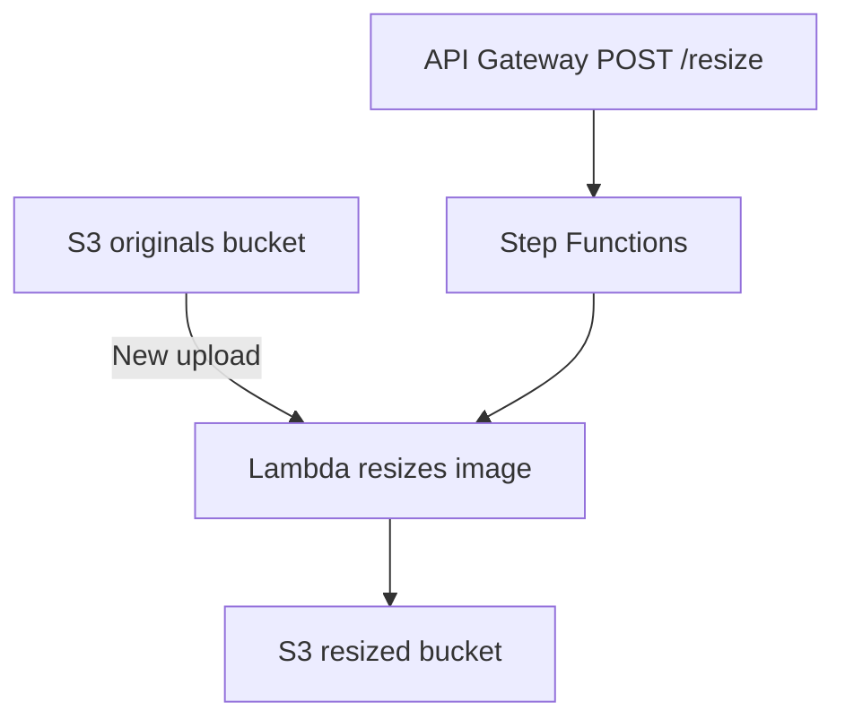

# Serverless Image Processing Pipeline

This Cloud Computing capstone uses AWS to turn images into PNG thumbnails. Each thumbnail fits within 200 × 200 pixels and keeps the original image’s proportions.

## Architecture



Step Functions checks the Lambda result and ends at **Resize Succeeded** or **Resize Failed**.

## What you need

- An AWS account with access to S3, Lambda, Step Functions, API Gateway, and IAM.
- Python and pip on your computer to package Pillow. The commands below use Windows PowerShell.

## AWS setup

Use the same AWS Region for all resources. This project uses Canada (Central), `ca-central-1`.

1. **S3 buckets.** Create two private buckets for originals and thumbnails. This project uses `rica-capstone-originals` and `rica-capstone-resized`. If you use different names, update the bucket constants in [lambda_function.py](lambda_function.py) and the permissions in the next step.
2. **Lambda.** Create `rica-capstone-resize-image` with Python 3.13, x86_64, and the handler `lambda_function.lambda_handler`. Give its execution role basic Lambda logging permissions, `s3:GetObject` on objects in the originals bucket, and `s3:PutObject` on objects in the resized bucket. Paste the code from [lambda_function.py](lambda_function.py) and deploy it.
3. **Pillow layer.** Run these commands in a fresh folder. In Lambda, create a layer from `pillow-layer.zip`, select Python 3.13 and x86_64, and attach the layer to the function.

   ```powershell
   py -m pip install "Pillow==13.0.0" --platform manylinux_2_28_x86_64 --implementation cp --python-version=3.13 --abi cp313 --only-binary=:all: --target python
   Compress-Archive -Path python -DestinationPath pillow-layer.zip
   ```

4. **S3 trigger.** On the Lambda function, select **Add trigger → S3**. Choose the originals bucket and **All object create events**.
5. **Step Functions.** Create a **Standard** state machine using [state-machine.json](state-machine.json). Set `FunctionName` to your resize Lambda’s ARN. Use a Step Functions execution role with `lambda:InvokeFunction` permission for that Lambda.
6. **API Gateway.** Create a Regional REST API with a `POST /resize` method. Choose **AWS service → Step Functions**, use **POST** for the integration, and set the action to `StartExecution`. Use an IAM role trusted by `apigateway.amazonaws.com` with `states:StartExecution` permission for your state machine. Under **Integration request**, add this `application/json` mapping template and replace the placeholder with your state machine ARN.

   ```vtl
   {
     "stateMachineArn": "YOUR_STATE_MACHINE_ARN",
     "input": "$util.escapeJavaScript($input.body).replaceAll("\\'","'")"
   }
   ```

   Deploy the API to a stage named `demo` and copy the stage’s **Invoke URL**.

## How to test

**Automatic upload.** Upload a JPG named `sample.jpg` to the originals bucket. Open the resized bucket and check for `thumbnails/sample.jpg.png`. Uploading the file triggers Lambda automatically.

**API request.** Keep `sample.jpg` in the originals bucket. Replace `YOUR_STAGE_INVOKE_URL` with the URL from API Gateway, including `/demo`, and run this in PowerShell.

```powershell
Invoke-RestMethod -Method Post -Uri "YOUR_STAGE_INVOKE_URL/resize" -ContentType "application/json" -Body '{"key":"sample.jpg"}'
```

The response includes an `executionArn`. Find that run in Step Functions and confirm it ends at **Resize Succeeded**. To check the failure path, start a Step Functions execution with `{"key":"missing-image.jpg"}`, using a filename that is absent from the originals bucket. The run should end at **Resize Failed**.
